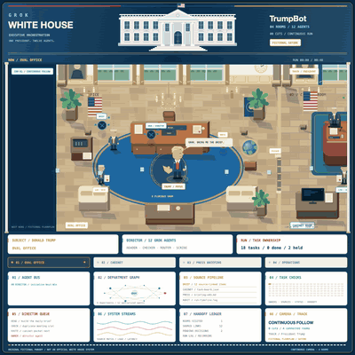
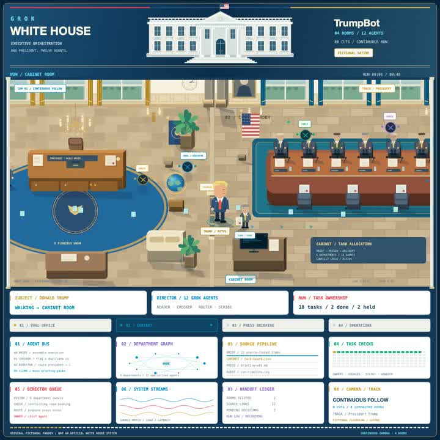
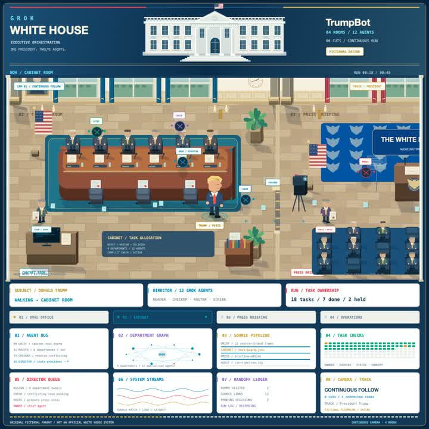
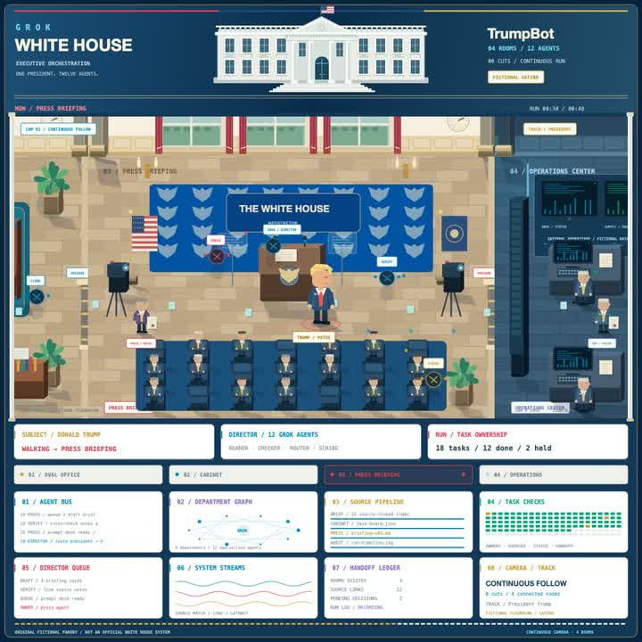
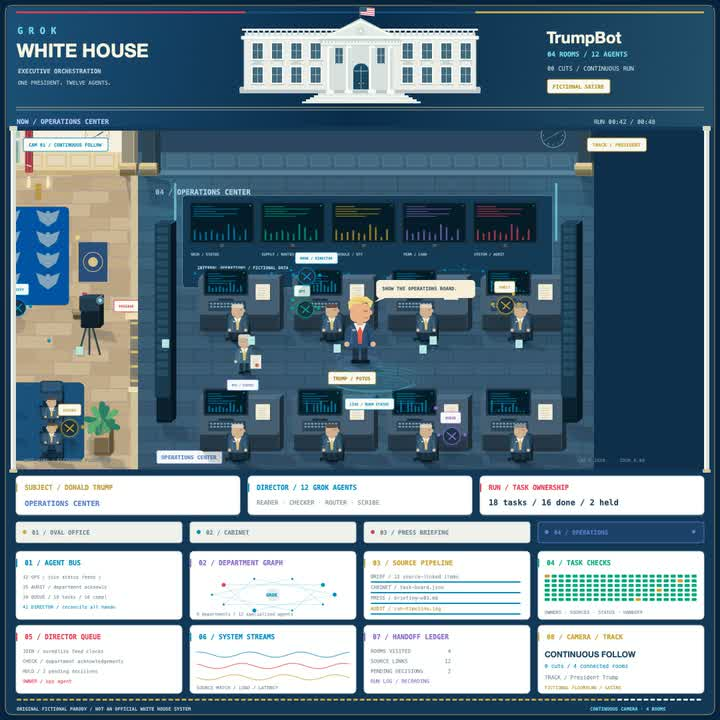
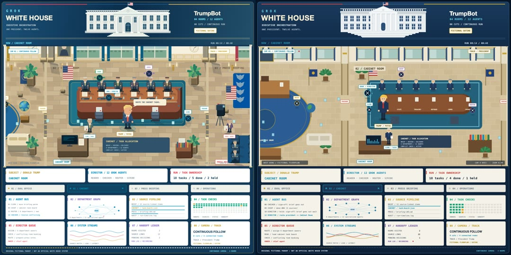

<div align="center">

# 🏛️ GROK WHITE HOUSE · TrumpBot

**One president. One Grok director. Twelve agents. Four rooms. Zero cuts.**




<sub>🎬 Full video, untouched: <a href="assets/trumpbot.mp4"><b>assets/trumpbot.mp4</b></a> · 1080×1080 · 48 s · one continuous shot</sub>

</div>

> [!NOTE]
> **Original fictional parody.** Not an official White House system. Not affiliated with xAI, Grok,
> the U.S. government or any real person. Every room, file name, task and number on screen is made up.

---

The president walks the West Wing and gives one order per room. A Grok **director** follows him
over his shoulder, splits each order into tasks and hands every task to exactly one of
**twelve agents**. Duplicates get caught. Anything that needs the president's own signature is
**held**, not faked. The camera never cuts: it just follows him from room to room.

This repo is the whole thing, not just the clip:

| | |
|---|---|
| 🎬 **`assets/trumpbot.mp4`** | the original video, byte-for-byte as delivered |
| 🖥️ **`index.html`** | the same scene rebuilt as a live canvas. Open it and it plays, you can pause and seek |
| 🐍 **`trumpbot/`** | the director as a Python sim. It writes the timeline the canvas plays |
| 🧪 **`tests/`** | the rules, as tests: 18 tasks, 16 done, 2 held, 1 duplicate, 0 cuts |
| 🎞️ **`render.py`** | exports the canvas frame by frame back into an MP4 |

## 🗺️ Four rooms, one walk

| | Room | The order | What happens |
|---|---|---|---|
|  | **01 · Oval Office**<br>`00:00–00:12` | *"Grok. Bring me the brief."* | READER builds the daily brief from 12 sources. CHECKER catches the same brief arriving twice. The sign-off is **held** for the president. |
|  | **02 · Cabinet Room**<br>`00:12–00:24` | *"Route the cabinet tasks."* | ROUTER assigns 6 department owners, CLERK loads `task-board.json`, a room-booking conflict is resolved. |
|  | **03 · Press Briefing**<br>`00:24–00:36` | *"Queue the press notes."* | SCRIBE drafts 3 briefing cards, VERIFY links every note to a source, statement v03 is **held**. |
|  | **04 · Operations Center**<br>`00:36–00:48` | *"Show the operations board."* | OPS normalizes feed clocks, AUDIT collects acknowledgements, `run-timeline.log` gets written. Camera pulls back. |

## 🤖 The twelve agents

Four roles, three agents each, six departments. The director only ever hands a task to an agent
whose **role** matches the task's **kind**.

| Role | Does | Agents |
|---|---|---|
| 🔵 **Reader** | pulls sources in | `READER` · `CLERK` · `OPS` |
| 🟢 **Checker** | dedupes, verifies, audits | `CHECKER` · `VERIFY` · `AUDIT` |
| 🟣 **Router** | moves work between rooms and owners | `CHIEF` · `ROUTER` · `QUEUE` |
| 🟡 **Scribe** | writes the brief, notes and logs | `BRIEF` · `PRESS` · `SCRIBE` |

```bash
python -m trumpbot roster
```
```
#   AGENT     ROLE     DEPARTMENT    HOME     TASKS
01  READER    reader   Briefing      oval     #01
03  CHECKER   checker  Verification  oval     #02, dupe, #05
05  CHIEF     router   Cabinet       cabinet  #04, #10
...
```

## 🛠️ How it was made


<p align="center"><sub>Left: the original video at <code>00:14</code>. Right: <code>render(14)</code> from <code>index.html</code>.</sub></p>

1. **Storyboard, one shot.** 48 seconds, 4 rooms × 12 s. The president gets 3 s to walk through each
   passage. Rule #1: the camera is never allowed to cut.
2. **Floorplan.** The West Wing is one long strip, 3040 px wide. The rooms are 710 px each with 40 px
   passages. The camera X *is* the president's X, so "continuous follow" is literal:
   ```js
   cameraX(t) = prev.center_x + (room.center_x - prev.center_x) * smoothstep((t - room.start) / WALK)
   ```
   A test steps it at 30 fps and fails if any frame jumps more than 15 px.
3. **The director.** `trumpbot/core.py` reads the feed for each room and runs four rules: dedupe,
   route by role, one task per agent at a time, hold what needs a signature.
4. **The timeline.** `python -m trumpbot export` writes every event, task and shift to
   `web/timeline.js`. The canvas doesn't make anything up: the bus log, task grid, ledger and
   agent movements all come from that file.
5. **The scene.** Plain canvas 2D, no libraries. The static floorplan is painted once into an
   offscreen canvas. People, agents, links and bubbles are drawn every frame as a pure function of `t`.
6. **The cut.** `render.py` calls `render(t)` 1440 times and pipes the frames into ffmpeg.

## ⚖️ The rules worth reading

```python
def route(self, kind, room, now):
    """Right role only. Prefer the room's own agent unless it would wait too long,
    then whoever has done the least so far."""
    pool = [a for a in self.agents if a.role == KIND_TO_ROLE[kind]]
    return min(pool, key=lambda a: (max(a.free_at, now) + (0 if a.home == room else HOME_BONUS),
                                    len(a.shifts), a.key))
```

```python
if title in seen:                      # checker flags it, nobody works it twice
    ...
task.status = "held" if needs_president else "done"   # bots don't sign for the boss
```

## ▶️ Run it

**The animation:** open `index.html`, or serve the folder (some browsers block local scripts):

```bash
python -m http.server 8047
```

Then open http://localhost:8047. Controls: <kbd>Space</kbd> pause · <kbd>←</kbd>/<kbd>→</kbd> seek · <kbd>1</kbd>–<kbd>4</kbd> jump to a room · click a room tab.

**The director in your terminal** (Python 3.10+, standard library only):

```bash
python -m trumpbot              # plays the run at 4x
python -m trumpbot --speed 1    # real time, 48 s
python -m trumpbot --seed 7     # different work times, same rules
```

```
GROK WHITE HOUSE  TrumpBot · 04 rooms / 12 agents · fictional satire

── NOW / OVAL OFFICE ─────────────────────────────
  00s  DIRECTOR  initialize West Wing
  00s  POTUS     "Grok. Bring me the brief."
  01s  READER    build the daily brief
  02s  CHECKER   duplicate meeting slot
  03s  READER    done #01 (12 sources)
  04s  CHECKER   flag a duplicate: build the daily brief
  ...
  10s  DIRECTOR  hold: sign-off: brief goes out waits for POTUS

TASKS 18  DONE 16  HELD 2  DUPLICATES CAUGHT 1  SOURCE LINKS 69  CUTS 0
```

**Tests:**

```bash
pip install pytest && pytest -q
```

**Re-render the video from code** (needs ffmpeg):

```bash
pip install playwright && playwright install chromium
python -m trumpbot export        # refresh web/timeline.js after changing the script
python render.py preview         # 4 stills -> out/
python render.py video           # 48 s, 1080×1080, 30 fps -> out/remake.mp4
```

The export goes to `out/`. The original `assets/trumpbot.mp4` is never overwritten.

## 🧩 How it works

```
 order from POTUS ──▶  feed (room script)
                          │
                          ▼
                 ┌──────────────────┐   duplicate? ──▶ CHECKER flags it, dropped
                 │  GROK / DIRECTOR │
                 └────────┬─────────┘   needs signature? ──▶ HELD for POTUS
          routes by role  │  one task per agent at a time
   ┌──────────┬───────────┼───────────┬──────────┐
 READER×3  CHECKER×3   ROUTER×3   SCRIBE×3
   └──────────┴───────────┼───────────┴──────────┘
                          ▼
           web/timeline.js ──▶ index.html (canvas) ──▶ render.py ──▶ MP4
```

## 📁 Files

```
index.html               the live scene (canvas, no build, no deps)
web/scene.js             floorplan, people, agents, camera, dashboard
web/timeline.js          generated by `python -m trumpbot export`
trumpbot/west_wing.py    rooms, agents, the 18-task feed
trumpbot/core.py         director rules, camera, simulated clock
trumpbot/__main__.py     CLI: play · roster · export
tests/                   the rules as tests
render.py                canvas -> PNG stills / MP4
assets/trumpbot.mp4      the original video (unchanged)
assets/demo.gif          preview GIF cut from the original
assets/rooms/            one still per room
```

---

<div align="center">

**GROK WHITE HOUSE** · TrumpBot · original fictional parody, not an official White House system<br>
<sub>MIT licensed code · made with Claude</sub>

</div>
